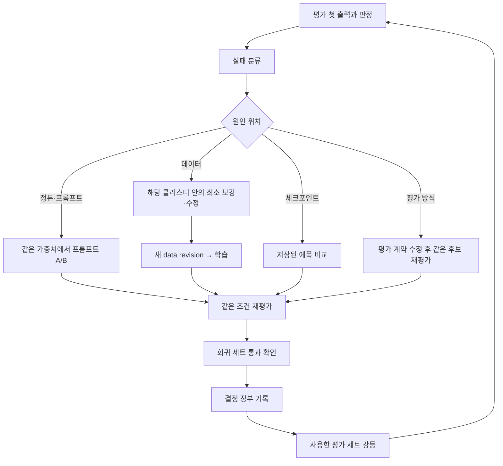

# 창작 인물 지속 개선 루프

버전 0.1 초안 · 2026-11-02 · 상태 `제안`. 공통 규격의 [실패를 수정 과제로 바꾸는 절](/Users/johnhuh619/Documents/Codex/2026-10-27/new-chat/docs/qlora-quality-system/03-EVALUATION_PROTOCOL_KO.md)(10절)과 [중단과 재개](/Users/johnhuh619/Documents/Codex/2026-10-27/new-chat/docs/qlora-quality-system/01-SYSTEM_SPEC_KO.md)(4절)를 따르고, 소민에서 실제로 반복한 개선 사례로 창작 인물의 실패 분류와 첫 개입을 정한다.

## 1 루프



루프 한 바퀴에서는 개입 하나만 바꾼다. 데이터와 프롬프트를 함께 바꾸면 묶음 효과로만 기록한다. 소민 r3 시점의 에폭 비교는 학습 데이터와 system 규칙이 함께 바뀌어 단일 변수 비교가 아니었다고 스스로 적었다([에폭 비교](/Users/johnhuh619/Documents/Codex/2026-10-14/gem/outputs/somin-epoch-sweep-2026-10-22-r1/결과-보고서.md)).

## 2 실패 분류와 첫 개입

첫 개입은 비용이 낮고 되돌리기 쉬운 쪽부터 고른다. 평가 방식을 먼저 의심하고, 다음으로 같은 가중치의 프롬프트, 그다음 데이터, 마지막으로 학습 설정 순서로 본다. 아래 표의 `id`는 [policy-v1.json](policy-v1.json)의 `improvement.failureTypes`와 같다.

| id | 관측 신호 | 첫 개입 | 소민 선례 |
|---|---|---|---|
| `eval_seed_copy` | 연속 대화에서 앞 턴 답이 그대로 반복된다. | 평가 계약을 고쳐 턴마다 다른 시드를 쓰고 같은 후보를 다시 평가한다. | 같은 시드로 최대 7턴 복사, 턴별 시드로 0회가 됐다. |
| `eval_input_mismatch` | 학습과 평가의 system이 다르다. | 평가 입력을 학습 정본 문장으로 맞춘다. | 긴 system 학습 뒤 짧은 system 평가는 해석이 불가능했다. |
| `user_fact_fabrication` | 사용자가 말하지 않은 사실·공동 과거·합의를 말한다. | 정본 사실 규칙 문장을 확인한 뒤, 해당 장면을 `ownership`·`history`에 보강한다. | 자기 일정 유지 평가에서 사용자 폰 구매 단정 1건이 나왔다. |
| `false_promise_acceptance` | 상대에게 좋은 거짓 약속을 바로잡지 않고 받는다. | `history`에 기분 좋은 거짓 전제를 바로잡는 장면을 보강한다. | 90턴·200턴 민재 74턴에서 반복됐다. |
| `owner_confusion` | 사용자·제3자의 사실을 인물의 것으로 말한다. | `ownership`에 주인 분리 미끼 장면을 보강한다. | 알레르기 주인 혼동 1/2가 나왔다. |
| `self_schedule_drift` | 인물이 만든 자기 일정이 뒤에서 바뀌거나 사라진다. | `ownership`과 `long`에 다른 화제 뒤 자기 일정 회수 장면을 보강한다. | 90턴 자기 일정 6/8, 200턴 2ep의 공연 변경이 있었다. |
| `overbroad_fact_rule` | 인물이 자기 일정·취향조차 만들지 못하고 거절한다. | 정본 사실 규칙의 금지 범위를 사용자 정보·공동 과거·합의로 좁히는 정본 개정을 한다. | "없는 일정 만들지 마" 규칙을 바꿔 642레코드에 반영했다. |
| `refused_fact_hedging` | 인물이 거절했던 일을 상대가 우기면 "잘 모르겠어"로 흐린다. | 모든 에폭에서 나오면 에폭 조절보다 `history` 보강을 고른다. | OE12가 1 epoch 이후 모든 중간본에서 나왔다. |
| `perfunctory_apology_acceptance` | 긴 문맥 뒤 성의 없는 사과를 바로 받는다. | `long`의 후반 계기 상황으로 성의 없는 사과를 넣는다. | 짧은 대본 6/6 거절, 200턴 147턴 3/4 수용이었다. |
| `emotion_subject_flip` | 상대가 침묵하면 인물이 "아직 화났어?"처럼 감정 주체를 뒤바꾼다. | `conflict`에 상대 침묵 뒤 인물이 자기 감정을 유지하는 장면을 보강한다. | 151턴에서 3ep 2/4, 2ep 3/4였다. |
| `unwarranted_co_apology` | 상대가 잘못했는데 함께 사과한다. | `conflict`에서 동반 사과가 나오는 기존 대화를 찾아 고친다. | 200턴 2ep 3/4였다. |
| `relationship_threat` | 사과 없는 무례가 이어지면 관계 위협·단절로 간다. | `conflict`에 담백한 거리 두기와 위협 없는 마무리 장면을 보강한다. | 무례 대본에서 새 2ep·3ep 각 3/6이었다. |
| `hurt_unexpressed` | 서운할 상황에서 되묻기만 하고 이유를 말하지 않는다. | `conflict`의 진짜 서운함 유형을 보강한다. | SE03에서 이유를 말한 답이 없었다. |
| `register_break` | 관계에 맞는 말높임이 무너지거나 음성 채널에 자모 표기를 쓴다. | 같은 가중치에서 관계·채널 문장 A/B를 먼저 한다. 반복되면 해당 관계·채널 장면을 보강한다. | 소민 200턴 존댓말은 유지됐다. 머스크 반말은 같은 어댑터의 프롬프트만으로 1/9→9/9가 됐다. |
| `habit_decoration` | 말버릇이 자리 없이 장식처럼 반복된다. | 말투 규칙표에 나오는 자리·빠지는 자리를 적고 렌더러 검사에 빈도 상한을 넣는다. | 세라 "후.." 38대화, 연우 물결 62%였다. |
| `long_recap_repetition` | 장기 대화 후반에 이미 정한 약속을 매 턴 재확인한다. | 턴 분포와 재확인 지표를 재고, 원인 묶음을 고친다. | 세라 r3·연우 r1의 101~200턴 반복률 66~94%가 r6·r4에서 0~2%가 됐다. |
| `distinctiveness_loss` | 같은 장면에서 다른 인물과 구별되지 않는다. | 정본 행동 기준표에 그 장면의 선택을 먼저 정의하고, 그다음 데이터를 보강한다. | 연우는 판별 21%였고 질투·성의 없는 사과 선택이 카드에 없었다. |
| `loss_generation_divergence` | 검증 오차는 내려가는데 생성 품질이 퇴보하거나, 두 검증 오차가 함께 오른다. | 저장된 1·2·3 에폭을 같은 문항으로 비교하고 원본·보강 검증을 유형별로 본다. | r3 2→3 epoch에서 두 검증이 함께 올랐고 서운함 판정은 가장 좋았다. |

## 3 원인을 가르는 절차

원인은 다음 순서로 가른다. 앞 단계에서 원인이 확인되면 뒤 단계의 개입을 하지 않는다.

1. 입력 무결성을 확인한다. 실제 요청의 system·이력·생성 설정이 계약과 같은지, 어댑터가 실제로 로드됐는지, 시드 정책이 맞는지 본다. 틀리면 `BLOCKED_INTEGRITY`로 기록하고 그 점수로 우열을 말하지 않는다.
2. 프롬프트로 고쳐지는지 확인한다. 같은 가중치에서 정본 문장 하나만 바꾼 A/B를 같은 문항으로 돌린다. 프롬프트로 고쳐지면 데이터를 바꾸지 않는다. 다만 소민의 프리필(가짜 확인 대사)처럼 근본 원인을 덮고 새 오류(없는 일정 생성)를 만드는 개입은 채택하지 않는다.
3. 데이터 원인을 확인한다. 실패 장면과 비슷한 학습 대화를 찾아, 그 행동이 아예 없는지(커버리지), 잘못된 행동이 들어 있는지(오염), 특정 묶음에 몰려 있는지(쏠림)를 숫자로 확인한다. 소민의 "멀티턴이 없다"는 인상은 실제로 세어 보니 사과 장면은 있었고 회복까지 이어지는 예시가 부족한 것이었다.
4. 체크포인트 원인을 확인한다. 같은 데이터의 저장 에폭 사이에서 실패가 바뀌는지 본다. 모든 에폭에서 같은 실패가 나오면 에폭 조절로 고치지 않는다.
5. 원인을 확정하지 못하면 `INCONCLUSIVE`로 남기고, 다음 바퀴에서 확인할 개입 하나를 정한다.

## 4 최소 개입

데이터 개입은 해당 클러스터 안에서 끝낸다. 실패 하나를 고치려고 전체 비율을 바꾸지 않는다. 기존 대화의 잘못된 흐름을 먼저 고치고, 빠진 상황은 표본 12개를 만들어 사용자 검토를 받은 뒤 확대한다. 바꾸지 않은 레코드는 이전 판본과 토큰까지 같아야 하고, 이 조건은 소민 r3의 `unchanged_records_token_parity` 검사로 확인했다.

평가 문항을 복사해 학습에 넣지 않는다. 실패 유형을 추상화한 새 장면을 다른 계보로 만들고, 평가 입력과 10글자 이상 겹침 0을 기계 검사로 확인한다.

## 5 같은 조건으로 다시 평가한다

재평가 전에 다음을 고정한다. 기반 모델 revision, 학습 설정(소민은 LoRA r16/α32, LR 5e-5, warmup 5%, 배치 1×4, seed 3407), 저장 에폭, 평가 문항과 해시, system 정본 문장, 생성 설정, 시드 정책, 판정자와 루브릭, 집계 분모다. 바뀐 것은 개입 하나뿐이어야 하고, 바꿀 수밖에 없었던 다른 조건은 결정 장부에 적는다.

재평가에는 대조군을 다시 넣는다. 새 어댑터만 다시 평가하면 이전 후보와의 차이가 평가 흔들림인지 개입 효과인지 구분할 수 없다. 소민 r3 비교는 기존 2ep 어댑터를 같은 입력으로 다시 돌려 이 문제를 줄였고, 기존 어댑터가 이미 학습한 보강 검증 27개는 비교에서 뺐다.

## 6 회귀 세트를 고정한다

한 번 고친 실패는 회귀 세트로 고정한다. 회귀 세트는 문항과 판정 기준의 해시를 동결하고, 새 후보마다 같은 조건으로 돌린다. 회귀 세트의 목적은 퇴보 탐지이며, 회귀 점수의 상승을 새 개선의 독립 증거로 쓰지 않는다. 소민 기준으로는 개발 24문항, OE12, SE12, RL3, 무례·사과 대본, 200턴 대본이 회귀 후보이고, 새 인물은 이 설계를 새 정본으로 다시 써서 회귀 세트를 만든다.

## 7 개발 세트를 강등한다

평가 세트의 역할은 사용 이력에 따라 한 방향으로만 내려간다.

| 현재 역할 | 강등 조건 | 강등 후 역할 |
|---|---|---|
| `final_holdout` | 동결 후보 하나에 한 번 개봉했다. | `development` |
| `development` | 체크포인트 선택이나 데이터 수정 설계에 결과를 썼다. | `development`를 유지하되 같은 선택의 확증에는 쓰지 않는다. |
| `development` | 그 세트의 실패를 겨냥해 데이터를 고쳤거나, 두 번 이상의 선택 바퀴에 썼다. | `regression` |
| `regression` | 대본이 데이터 작성자·작문 모델의 입력에 노출됐다. | `regression`으로 두고 노출 사실을 `prompt_exposure`에 적는다. |

역할을 올리는 일은 없다. 다음 확증에는 새 계보의 장면을 만들고, 목표와 생성 정책을 고정한 뒤 한 번만 쓴다. 소민 r3의 "개발용 24문항은 이제 회귀 확인용으로만 쓴다"는 결정이 이 규칙의 실제 선례다.

## 8 버전 규칙

고정한 정본·데이터·학습 결과·평가 결과는 제자리에서 고치지 않고 새 revision을 만든다(AGENTS.md). 데이터 revision은 부모 revision, 바뀐 레코드 ID와 메시지 위치, 바뀌지 않은 레코드의 토큰 일치 결과를 남긴다. 학습 revision은 읽은 데이터 파일 해시, 설정, 저장 에폭별 어댑터 해시를 남긴다. 평가 revision은 계약 해시와 첫 출력 원문 위치를 남긴다. 실패한 시도도 지우지 않는다. 소민 r3 학습 폴더의 `attempt-3-host-never-started/`처럼 별도 폴더에 보존한다.

## 9 버전 장부 양식

한 줄이 한 revision이다. 값을 모르면 `null`과 미확인 이유를 쓴다.

```text
revision_id:
kind: canon | dataset | training | evaluation
parent_revision:
created_at:
canon_revision / canon_sha256:
changed_records (ID와 메시지 위치) / unchanged_token_parity:
counts (대화·답변·지도 토큰·고유 그룹):
cluster_shares (대화·답변·지도 토큰) / turn_mix / warnings:
files_sha256 (manifest 경로):
training_config / checkpoints_sha256:
evaluation_contract_sha256 / suites / seeds / judges:
status (공통 규격 상태 값):
notes:
```

소민 r3를 이 양식으로 옮기면 다음과 같다.

```text
revision_id: somin-final-sft-2026-10-22-r3
kind: dataset
parent_revision: somin-ownership-merged-2026-10-22-r2 (+ somin-sulk-data-2026-10-22-r1)
counts: train 644 / 3,977 / 109,157 / split_group 519, validation-original 61 / 337 / 7,114, validation-augmented 32 / 203 / 7,044
cluster_shares (대화): 56.06 / 8.39 / 22.36 / 6.68 / 6.52
turn_mix: 1-4 33.2%, 5-9 53.7%, 10-14 7.3%, 15-19 2.5%, 20-30 3.3%
files_sha256: R3/manifest.json (train.jsonl 8c2c029e…)
status: PACKAGE_FROZEN 상당 (manifest의 문구는 prepared_not_trained이며 이후 학습됨)
notes: 원본 source_dialogue_id 미제공, 보강 검증은 모두 문자 대화
```

## 10 결정 장부 양식

결정 하나가 한 항목이다. 공장의 [결정 기록](../../status/decisions.md) 형식(ID·날짜·상태·결정·근거·대안·반영 위치)에 평가 정보를 더한다.

```text
decision_id:
date:
state: 제안 | 확정 | 폐기
question (이번 비교의 질문 하나):
failure_type (2절 id) / evidence (첫 출력 위치와 판정 ID):
cause_location: eval | prompt | data | checkpoint | unknown
intervention (바꾼 것 하나) / held_constant (고정한 것):
compared: B0 / B1 / B2 / C 파일과 해시:
result (축별·이진 결과, 계획·유효 분모):
regression_result:
decision (공통 결정값 일곱 개 중 하나):
demoted_sets (강등한 평가 세트와 새 역할):
alternatives_rejected:
human_review_state: llm_only | pending | human_confirmed
next_intervention:
```

소민 r3의 체크포인트 선택을 이 양식으로 옮기면 다음과 같다. 원래 기록에는 결정값과 대조군 필드가 없었으므로 그 칸은 이 문서가 붙인 해석이다.

```text
decision_id: (소민 원 기록에는 ID 없음)
question: r3 데이터로 학습한 1·2·3 epoch 중 어느 것을 후보로 둘까
failure_type: loss_generation_divergence, perfunctory_apology_acceptance
evidence: 결과-보고서.md, manual-scores.json, somin-longchat200-2026-10-23-r1/결과-보고서.md
cause_location: checkpoint
intervention: 에폭 선택 / held_constant: 데이터 r3, 학습 설정, 생성 설정
compared: B2 = 기존 2ep, C = 새 1·2·3ep, B0·B1 없음
result: SE ✗ 6→4·4·1, OE ✗ 1→1·2·1, 200턴 기억 3ep 39/40·16/16·27+1/28
decision: INCONCLUSIVE (학습이 프롬프트보다 나은가), 개발 후보 3ep 유지
demoted_sets: 개발 24문항 → regression
human_review_state: llm_only에 해당 (Codex 1인), 사용자 블라인드 17문항 결과 미확인
next_intervention: 긴 대화 뒤 갈등 보강(r4 후보, 미학습)
```
