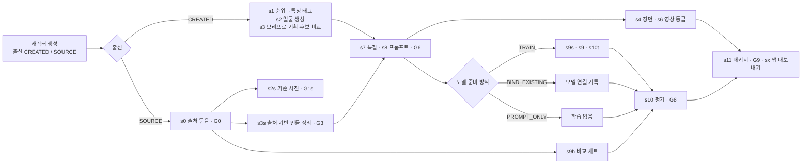

# 실존 인물 갈래 설계·시연 계획

- 날짜: 2026-11-08
- 상태: 방향 확정(D-0116~D-0119, D-0121, D-0122, D-0124, D-0126), 세부는 제안(D-0120, D-0125와 본문의 수치·이름·명령). D-0123은 D-0126으로 대체됐다.
- 미결: Q-0030(이름 체계)
- 반영 대기: PRD·명세·LLD는 착수 때 고친다(§15). 이 문서를 쓸 때 세 문서는 다른 세션이 고치는 중이었다.

## 1. 배경과 목표

공장 시연 피드백은 세 가지다. (1) 공장에서 손흥민 같은 실존 인물로 생성한다. (2) 부모님도 함께 병렬로 돌리고, 생성된 영상을 실제 카톡 화면과 나란히 보여 비슷함을 보인다. (3) 영상 분량을 5·20·60편 같은 편수 대신 light·standard·pro·max 같은 등급으로 고른다.

공장은 지금 "없는 사람을 지어내는" 공정이고, 실존 인물을 막는 장치가 여러 단계에 있다(D-0017, PRD §10 비목표, S2 이미지 규칙, 테스트 경로 이미지 프롬프트, S6 중립 표정 프롬프트). 이 장치를 풀지 않고, 같은 공장 안에 실존 인물 갈래를 두 번째 갈래로 더한다(D-0116). 창작 갈래의 규칙은 그대로 둔다.

시연 목표는 손흥민(공인)과 부모님 한 분(사인), 두 캐릭터를 한 번의 실행으로 병렬로 돌려, 앱 통화와 "실제 대화 vs 생성" 비교 화면까지 가는 것이다(D-0117, D-0121). 발표는 SW마에스트로 최종 발표이고 영업·광고 목적이 아니다. 발표용 패키지는 발표 점검 네 가지를 지킨 뒤 낸다(D-0126).

이 계획이 기대는 실측은 다음과 같다.

| 근거 | 값 | 출처 |
|---|---|---|
| 캐릭터 한 명의 기계 생성 시간(순위·태깅·후보 10장·장면 3장·영상 2편·S3·S7) | 약 20분. 시작부터 앱 대화 확인까지 전체는 2시간 56분 | 2026-11-07 시험 경로 `runs/testpath/20261107-seeds-r3-signature` |
| 영상 한 편(Grok, 720p, 6초) | 약 $0.84, 46초~3분 33초 | 같은 실행 `videos/s07-b3/*.json` |
| 공급자 호출 한도(429)로 멈춘 시간 | 1시간 27분 | 같은 실행 S3 `ledger/stage-events.jsonl` |
| 앱이 스테이지를 여는 최소 영상 수 | 10편(api-svc `stage.min_clips`) | api-svc 마이그레이션 099. 시험 경로에서 2편으로는 스테이지가 열리지 않았다 |
| 같은 브리프 후보 3명의 캐릭터성 | 정의된 상황의 첫 행동은 3명 모두 따랐다. 정의 밖 상황에서 누구 말인지 맞힌 비율은 11/12·0/12·11/12 | 2026-11-08 검사(작업 폴더 `work/cv/eval`, 모델 심사만) |

## 2. 범위

첫 판에 넣는 것: 출신 표시, 출처 묶음, 기준 사진, 출처 기반 인물 정리, 챕터 틀, 모델 준비 방식 세 가지, 영상 등급, 비교 평가, 여러 캐릭터 병렬 실행, 앱 내보내기 연결.

첫 판에 넣지 않는 것:

- 공장의 자동 수집. 출처 묶음은 사람이 파일로 넣는다(D-0120).
- 음성 복제. 이 계획 밖에서 따로 진행한다(D-0124). 공장은 음성 연결 칸(voice-svc 음성 ID)만 받고, 비어 있으면 기본 음성을 쓴다.
- 특별 행동 영상. 지금처럼 미구현으로 둔다.
- 서비스 출시 판단.
- 다른 저장소 수정. 필요한 변경은 §11에 제안으로만 적는다.

## 3. 갈래 구조

캐릭터마다 만들 때 출신(origin)을 정한다. 값은 CREATED(창작)과 SOURCE(실존)이고, 만든 뒤에는 바꾸지 않는다. 그래프는 지금 외모 축 판단(`_appearance_axis`)과 같은 방식으로, 출신에 따라 단계를 건너뛰고 선행 단계를 바꾼다.

| 단계 | 창작 갈래 | 실존 갈래 |
|---|---|---|
| 출처 | 없음 | **s0 출처 묶음**(새 단계), G0 출처·사용 근거 확인 |
| 얼굴 | s1 순위 → 특징 태그, G1 얼굴 고르기, s2 기준 사진 | **s2s 받은 사진으로 기준 사진**(새 단계), G1s 본인과 닮았는지 확인 |
| 기획 | s3 브리프 → 후보 여러 개 → G3 선택 | **s3s 원문에서 인물 정리**(새 단계), 후보 1개, G3는 원문 대조 |
| 특질·프롬프트 | s7, s8, G6 | 같음. 말투 예시는 원문에서 고른다 |
| 장면·영상 | s4a·s4b·s4, s5, s6 | 같음. 챕터 틀과 영상 등급을 따른다 |
| 데이터·학습 | s9s·s9·s10t | 모델 준비 방식에 따라 실행하거나 건너뛴다(§7) |
| 비교 세트 | 없음 | **s9h 비교 세트**(새 단계). 원문에서 떼어 둔 대화 |
| 평가·패키지·내보내기 | s10·G8, s11·G9, sx | 같음. s10은 비교 보고를 함께 쓴다(§9) |

G2는 결번 그대로 둔다(D-0042). 새 관문은 G0과 G1s 두 개다.

구현(D-0128, 계획 순서 1)에서는 s2s·s3s를 새 단계 ID로 만들지 않고 s2·s3의 트윈 판으로 두었다. 트윈 그래프에서 s2는 G0 뒤에 돌고 관문 G1s를 갖고, s3는 G0 뒤에 돌고 G3를 그대로 쓴다. 그래서 뒤쪽 단계의 의존과 산출물 계약이 오리지널과 같다. 출신은 캐릭터 폴더의 `origin.json`에 한 번 쓰고, 없으면 오리지널이다.

격리 규칙은 다음과 같다.

- 창작 갈래의 이름 차단(name-guard), 회피 목록, 다음 단계로 이름을 넘기지 않는 검사는 그대로 동작한다.
- 실존 갈래의 이름·사진·원문은 그 캐릭터 폴더 밖으로 나가지 않는다. 다른 캐릭터의 입력, 회피 목록 계산, 공용 보고서에 넣지 않는다.
- 진행 화면과 패키지에는 출신을 표시한다.

## 4. 출처 묶음(s0, `source-pack-v1`)

출처 묶음은 사람이 만든다. 공장은 검사하고 정리할 뿐 수집하지 않는다(D-0120).

| 칸 | 내용 |
|---|---|
| subject | 표시 이름, 종류(PUBLIC_FIGURE·PRIVATE_PERSON) |
| usageBasis | 사인은 동의한 사람·날짜·허용 범위, 공인은 사용 범위(예: 내부 시연). 비어 있으면 G0를 잠근다 |
| photos | 파일 경로, 해시, 찍은 시기, 출처 |
| texts | 종류(INTERVIEW·ARTICLE·TRANSCRIPT·KAKAO_EXPORT), 파일 경로, 해시, 날짜, 언어 |
| speakerMap | 원문 화자 이름 → 대상 인물·사용자·기타 |
| holdout | 비교 세트 분리 규칙(제안: 날짜 뒤쪽 20%를 대화 단위로) |

정리 규칙은 다음과 같다.

- 원문은 Git 밖 `runs/`에 둔다. 테스트는 합성 자료만 쓴다.
- 카톡 내보내기는 모바일 텍스트와 PC CSV 두 형식을 읽는다(제안). 대상 인물의 메시지만 말투·사실 자료로 쓰고, 사용자의 메시지는 문맥으로만 쓴다. 다른 참여자의 이름과 전화번호는 가린다.
- 공인의 인터뷰·기사 원문은 발화자가 본인인 문장만 말투 자료로 쓰고, 기자의 서술은 사실 근거로만 쓴다.
- 비교 세트는 처음에 떼어 두고 학습 데이터, 프롬프트, 말투 예시 어디에도 넣지 않는다.

G0 화면은 메시지 수, 기간, 화자 지정 결과, 가린 항목 수, 비교 세트 크기, 사용 근거를 보여 준다.

## 5. 기준 사진(s2s, G1s)

받은 사진으로 s2와 같은 계약의 기준 사진과 외모 명세를 만든다. 얼굴을 새로 생성하지 않는다. 정면에 가까운 사진을 고르고 자른 뒤, 필요하면 편집으로 조명과 배경만 정리한다. 닮음은 G1s에서 사람이 확인한다.

실존 얼굴은 공급자가 거절할 수 있다. 착수 때 GPT Image 편집 1건과 Grok 첫 프레임 영상 1건으로 미리 확인한다(유료, `--execute`). 거절하는 공급자는 실존 갈래에서 끈다. S6 중립 표정 프롬프트의 "not based on any real individual" 문장은 실존 갈래에서 쓰지 않는다.

## 6. 출처 기반 인물 정리(s3s)

출력은 기존 기획 계약(`character-plan-v2`)과 같은 칸을 쓴다. 그래야 s7 이후 단계를 그대로 쓸 수 있다. 근거 종류에 SOURCE(원문 파일 해시·위치·인용)를 더한다.

- 성격, 말투, 같은 상황 선택(choices), 생활과 취향 칸마다 SOURCE 근거를 단다. 근거가 없는 칸은 비워 두고 지어내지 않는다.
- 같은 상황 선택은 원문에서 실제로 관찰한 반응으로만 쓴다. 2026-11-08 검사에서 정의된 선택은 프롬프트 지시대로 잘 나왔다. 그래서 선택이 원문에서 왔는지가 품질을 좌우한다.
- 후보는 1개다. G3는 칸마다 원문 인용을 옆에 두는 대조 화면이다.
- 챕터 틀을 고른다. ROMANCE(창작 기본), FAN_CALL(공인), FAMILY_CALL(가족) 가운데 하나다. 단계 이름, 관계 단계, S6 관계 메모(`STAGE_NOTES`), chat-svc 관계 프로필이 이 틀을 따른다.
- 말높임은 원문에서 측정해 챕터별로 기록한다. 2026-11-07에는 chat-svc 내보내기의 기본 경로가 모든 챕터를 `CASUAL`로 고정해, 해요체 페르소나가 앱에서 반말로 말했다. 이 문제도 함께 고친다.
- 말투 예시는 기존 `voice-pack-v1`으로 넣는다. 다만 "원본 화자의 사실을 옮기지 않는다"는 말투 자료 규칙은 창작 갈래에만 적용한다. 실존 갈래에서는 원문의 사실이 곧 본인의 사실이라 s3s 근거로 옮긴다. 비교 세트 원문은 어느 쪽에도 넣지 않는다.

## 7. 모델 준비 방식(D-0118)

| 방식 | 쓰는 경우 | 건너뛰는 단계 | 그대로 하는 것 |
|---|---|---|---|
| TRAIN | 원문이 충분하고 학습할 시간이 있다 | 없음 | s9s·G7a·s9·G7·s10t. 실존 갈래의 학습 데이터 원천은 실제 발언이다 |
| BIND_EXISTING | 이미 학습된 모델(어댑터·튜닝 모델·엔드포인트)이 있다 | s9s·s9·s10t(건너뛴 이유를 기록) | s9h 비교 세트, s10 평가, G8 |
| PROMPT_ONLY | 원문이 적거나 시간이 없다 | s9s·s9·s10t | s9h, s10 평가, G8. 긴 프롬프트와 원문 말투 예시만 쓴다 |

**BIND_EXISTING**은 연결 기록 `model-binding-import-v1`을 들여온다. 명령은 `cfp model bind <character_id> --binding binding.json`(제안)이다.

| 칸 | 내용 |
|---|---|
| provider | HF_ADAPTER·VERTEX_TUNED·ENDPOINT |
| ref, revision | 모델 참조와 커밋으로 고정한 revision. 브랜치 이름은 거절한다 |
| baseModel, baseModelRevision | 기반 모델과 revision |
| servingRoute | chat-svc 모델 설정 이름 또는 서빙 주소 이름 |
| provenance | 누가 언제 어떤 데이터로 학습했는지, 사용 근거 |

사전 확인은 무료로 한다. 토큰 신원과 저장소 소유를 함께 확인하는데, 비공개 저장소의 404는 "없음"과 "권한 없음" 둘 다일 수 있기 때문이다. 그 밖에 revision이 커밋인지, 어댑터 파일과 기반 모델이 맞는지 본다. 짧은 실제 생성 확인은 GPU가 필요하므로 `--execute`로만 한다.

**PROMPT_ONLY**는 지금 G8에서만 고를 수 있는 학습 없는 경로(D-0048, `s10_eval/prompt_only.py`)를 처음부터 고를 수 있게 앞당긴 것이다.

공통 규칙은 다음과 같다.

- 방식은 캐릭터를 만들 때 기본값으로 정하고, G6 뒤에 새 판으로 바꿀 수 있다.
- 어떤 방식이든 비교 세트로 평가하고 G8에서 사람이 결정한다.
- 공장은 GPU 서빙을 띄우지 않는다. 연결 기록과 chat-svc 모델 설정만 내보낸다. 어댑터 서빙은 머스크 데모의 서빙 도구(다른 저장소)를 쓴다.
- 지금 chat-svc 내보내기는 대화 모델을 상수로 고정한다(`DIALOGUE_MODEL`). 이를 캐릭터별 연결값을 쓰도록 바꾼다.

시연 기본값은 이렇다. 손흥민은 TRAIN이다(D-0122, 확정). 부모님은 PROMPT_ONLY로 시작하고 비교 결과를 본 뒤 TRAIN 여부를 정한다(제안). 데이터가 적을 때 학습하면 과거 메시지를 외워 되풀이하기 쉽다.

## 8. 영상 등급(D-0119)

| 등급 | 구성(제안) | 편수 | 영상 비용(편당 $0.84 기준) |
|---|---|---|---|
| light | 1챕터, 대기 + 핵심 감정 | 10 | 약 $8 |
| standard | 3챕터 × 10 | 30 | 약 $25 |
| pro | 3챕터 × 20 | 60 | 약 $50 |
| max | 3챕터 × 감정 세트 37 | 111 | 약 $93 |

- 앱이 10편 미만 단계를 열지 않으므로 챕터당 최소는 10편이다. 내보내기 검사에서 이 기준을 확인한다.
- 등급마다 챕터별 영상 목록을 S6 카탈로그에 고정한다. 대기 영상과 가장 자주 쓰이는 감정부터 채운다.
- S6의 기존 묶음 이름 `standard`(37편 전체)는 등급 이름과 겹치므로 내부 이름을 `full37`로 바꾼다(제안).
- 생성 시간은 실측이 2편뿐이라 등급별 시간은 병렬 생성으로 잰 뒤 적는다.

## 9. 비교 평가와 시연 화면

- s10은 비교 세트의 장면마다 직전 문맥을 넣어 답을 만들고, 실제 답과 나란히 놓은 비교 보고를 쓴다.
- 생성된 답이 학습 자료·프롬프트·말투 예시와 얼마나 겹치는지 재고, 외운 답으로 보이는 경우를 표시한다.
- 판정은 두 가지다. 하나는 생성 모델과 다른 계열의 심사 모델이 이름을 가리고 실제와 생성을 구별하는 것이고, 다른 하나는 가족이 이름을 가리고 고르는 것(선택)이다. 보고서는 모델 판정과 사람 판정을 나눠 적는다.
- 시연 화면의 카톡은 비교 세트에서만 고르고 다른 참여자를 가린다.

## 10. 여러 캐릭터 병렬 실행

- `cfp batch run --spec batch.json`(제안)으로 캐릭터마다 기존 `run_waves`를 함께 돌린다.
- 한 프로세스 안에서 공급자별 동시 호출 상한(텍스트 중계, 이미지, 영상)을 공유한다.
- 429는 상한을 지키며 기다린 뒤 재시도한다. 사람 개입 없이 이어 가고, 기다린 시간은 장부에 남긴다.
- 진행 화면의 전체 캐릭터 보기(D-0103)에 출신과 갈래를 표시한다.
- 시연 목표는 손흥민과 부모님 한 분, 2캐릭터 동시다(D-0121).

## 11. 앱 내보내기 연결

- 캐릭터별 대화 모델 연결, 챕터 틀에 따른 단계 이름, 챕터별 말높임을 내보낸다.
- 음성 연결 칸이 있으면 그 음성 ID를 내보낸다(D-0124).
- 다른 저장소 변경(제안, Q-0030): api-svc의 `partner` 값과 앱의 "여자친구 만들기" 버튼은 연애 틀을 전제로 한다. 팬·가족 틀에서 보일 값과 문구가 필요하다.

이름 체계(D-0125 제안, Q-0030에서 사용자가 고른다)는 세 층으로 나눈다.

| 층 | 코드 값 | 표시 이름(제안) | 바뀌는 것 |
|---|---|---|---|
| 갈래 | CREATED·SOURCE | 오리지널(Original)·트윈(Twin) | 공장 진행 화면, 패키지 표시 |
| 챕터 틀 | ROMANCE·FAN_CALL·FAMILY_CALL | 연애·팬 통화·가족 통화 | 챕터 흐름, S6 관계 메모, chat-svc 관계 프로필 |
| 앱 관계 틀 | 챕터 틀에서 내보냄 | 팬 통화: 첫 통화·친해지기·단골 팬, "통화 시작하기". 가족 통화: 안부·일상·속마음, "안부 전화하기" | 앱 단계 이름, 시작 버튼 문구 |

갈래 이름만 바꿔서는 앱의 연애 틀이 바뀌지 않는다. 앱 화면을 실제로 바꾸는 것은 세 번째 층이고, 앱·api-svc 변경이 필요하다. 외부 발표에서 "클론·복제"는 동의 없는 복제로 읽히기 쉬워 실존 갈래 표시 이름으로 "트윈"을 제안한다.

## 12. 계획표

담당은 "에이전트"(코드·문서·무료 검사)와 "사용자"(자료·동의·결정·유료 실행 승인)로 나눈다. 1~10은 가짜 공급자 테스트로 끝낼 수 있고, 11은 유료 실행, 12는 사람의 공개 판단이다.

| 순서 | 작업 | 산출물 | 완료 기준 | 검증 | 담당 | 선행 |
|---|---|---|---|---|---|---|
| 0 | 사용자 준비물 | 손흥민 사진·학습용 원문, 부모님 한 분의 사진·카톡 내보내기·외부 공개 범위까지의 동의, Q-0030 답 | 출처 묶음 2개를 만들 자료가 모였다 | 파일 목록 | 사용자 | — |
| 1 | 갈래 뼈대 | 출신 칸, 그래프의 갈래별 건너뛰기·선행, 새 단계 s0·s2s·s3s·s9h 자리 | 창작 갈래 실행 결과가 바뀌지 않고, SOURCE 캐릭터는 s1·s2·s3를 건너뛴다 | 기존 전체 테스트 통과 + 갈래 테스트 | 에이전트 | — |
| 2 | 출처 묶음 s0·G0 | `source-pack-v1`, 카톡 두 형식 읽기, 화자 지정, 가림, 비교 세트 분리, G0 화면 | 사용 근거가 없으면 잠기고, 비교 세트가 다른 산출물에 없다 | 합성 카톡·인터뷰 fixture 테스트 | 에이전트 | 1 |
| 3 | 기준 사진 s2s·G1s | s2와 같은 계약의 기준 사진·외모 명세, G1s 화면 | 받은 사진으로 s4·s5·s6 입력이 만들어진다 | 가짜 이미지 공급자 테스트 | 에이전트 | 1 |
| 4 | 출처 기반 인물 정리 s3s·G3 | SOURCE 근거, 빈칸 규칙, 챕터 틀, 말높임 측정, 원문 대조 G3 | 근거 없는 칸이 채워지면 검사가 실패한다 | 합성 원문 테스트 | 에이전트 | 2 |
| 5 | S7·S8 연결 | 원문 말투 예시, 챕터별 말높임, CASUAL 고정 수정 | 해요체 인물이 1챕터에서 반말 지시를 받지 않는다 | 내보내기 테스트 | 에이전트 | 4 |
| 6 | 모델 준비 방식 | 세 방식 선택, `model-binding-import-v1`, 무료 사전 확인, 단계 건너뛰기, s9h | 연결 모드에서 s10t를 건너뛰고 G8까지 간다 | 가짜 공급자 테스트, 브랜치 revision 거절 테스트 | 에이전트 | 1·2 |
| 7 | 영상 등급 | 등급별 목록, `full37` 이름 변경, 챕터 틀별 관계 메모, 10편 검사 | 등급만 바꿔도 S6 계획 편수가 표와 맞는다 | S6 dry run | 에이전트 | 1 |
| 8 | 비교 평가·시연 화면 | s10 비교 보고, 겹침 표시, 블라인드 판정 화면 | 비교 세트 답이 실제와 나란히 보인다 | 합성 비교 세트 테스트 | 에이전트 | 2·6 |
| 9 | 여러 캐릭터 병렬 | `cfp batch run`, 공급자별 상한, 대기 시간 장부, 진행 화면 표시 | 2캐릭터가 한 명령으로 돌고 상한을 넘지 않는다 | 가짜 공급자 동시 실행 테스트 | 에이전트 | 1 |
| 10 | 앱 내보내기 | 캐릭터별 모델 연결, 챕터 틀 단계 이름, 음성 연결 칸, 다른 저장소 변경 제안 | 로컬 시험 스택에 두 캐릭터가 적재된다 | 일회용 DB 적재 확인 | 에이전트 | 5·6·7 |
| 11 | 공급자 사전 확인과 리허설 | 실존 얼굴 이미지·영상 1건씩, 손흥민 학습, 손흥민·부모님 병렬 실제 실행, 단계별 시간 | 두 캐릭터가 앱 통화와 비교 화면까지 간다 | 실행 장부, 앱 캡처, 비교 보고 | 에이전트 실행·사용자 승인 | 0·10 |
| 12 | 발표 점검 | 필수: "AI 생성 · 본인과 무관한 기술 시연" 표시, 추천·협력처럼 보이는 표현 없음, 손흥민 장면을 홍보물·SNS·앱 마케팅에 다시 쓰지 않음, 부모님 발표 공개 동의. 권장: 손흥민 측 허락, 법무 검토. 발표 화면의 카톡 가림 | 필수 네 항목이 기록돼야 발표용 패키지를 낸다(D-0126) | 점검표와 발표 화면 캡처 | 사용자 결정·에이전트 정리 | 11 |

## 13. 비용 추정(제안)

캐릭터 한 명 기준으로 텍스트 단계는 약 $0.5, 이미지는 약 $0.2다(2026-11-07 실측 근거). 영상은 등급별로 §8을 따른다. standard 등급 2캐릭터면 영상만 약 $50이다. 손흥민 학습은 대여 GPU 시간당 약 $0.5~0.7(머스크 데모 기준)에 학습 시간을 곱한다. 리허설 전에 호출 수와 상한을 보고하고 승인받는다.

## 14. 위험

| 위험 | 영향 | 대응 |
|---|---|---|
| 공급자가 실존 얼굴 편집·영상을 거절한다 | 영상 단계가 막힌다 | 순서 11에서 먼저 1건씩 확인하고 대체 공급자를 정한다 |
| 외운 답이 비슷해 보인다 | 시연 주장이 무너진다 | 비교 세트 분리, 겹침 표시, PROMPT_ONLY부터 시작 |
| 부모님 원문이 적다 | 말투가 흐리다 | 원문 말투 예시를 우선하고 학습은 비교 뒤에 정한다 |
| 발표에서 공인의 얼굴·이름과 가족 자료를 보인다 | 발표 영상이 공개되거나 홍보에 재사용되면 성명·초상 분쟁, 동의 범위 문제 | G0 잠금, 순서 12 발표 점검(D-0126) |
| 429와 동시 실행 | 시간이 크게 늘어난다 | 공급자별 상한과 대기 장부 |
| 다른 세션과 문서·코드가 겹친다 | 충돌 | PRD·명세·LLD는 착수 때 반영하고, 그래프·내보내기 변경은 작은 단위로 나눈다 |

## 15. PRD·명세·LLD 반영 범위

- PRD: §4 범위에 실존 갈래를 넣는다. §8에 출처 묶음·기준 사진·출처 기반 인물 정리·모델 준비 방식·영상 등급·비교 평가 요구사항(새 FR)을 둔다. §10 비목표의 특정 인물 재현 금지를 창작 갈래 범위로 고친다. §12에 위험을 더한다.
- 명세: 공정 단계와 갈래, 새 관문 G0·G1s, 계약 이름(`source-pack-v1`, `model-binding-import-v1`), 근거 종류 SOURCE, 챕터 틀, 영상 등급.
- LLD: 그래프·오케스트레이터 분기, 새 단계 패키지, 명령(`cfp run`의 출신·출처 묶음 인자, `cfp model bind`, `cfp batch run`), 카톡 형식 읽기, 테스트, 다른 저장소 변경 절.

## 변경 이력

- 2026-11-08: 첫 판(D-0116~D-0120).
- 2026-11-08: 미결 답 반영. 부모님 한 분으로 2캐릭터(D-0121), 손흥민 TRAIN(D-0122), 최종 외부 발표와 공개 전 점검 순서 12(D-0123), 음성은 계획 밖(D-0124), 이름 체계 제안(D-0125).
- 2026-11-08: 발표 성격(SW마에스트로 최종 발표, 비영업)에 맞춰 순서 12를 발표 점검으로 완화했다. 허락·법무 검토는 권장으로 내렸다(D-0126, D-0123 폐기).
- 2026-11-08: 갈래 이름 오리지널·트윈 확정(D-0127). 순서 1(갈래 뼈대) 구현, s2·s3를 트윈 판으로 두는 방식(D-0128).
- 2026-11-08: 순서 2(s0·G0, D-0140), 순서 3(트윈 s2·G1s), 순서 4(트윈 s3·G3), 순서 7(영상 등급) 구현(D-0141). 오케스트레이터만으로 s0 → G0 → s2·s3 동시 → G1s·G3 대기 흐름을 합성 자료로 확인했다.
- 2026-11-08: 순서 5(S7·S8 연결, 말높임 고정 수정)와 순서 6(모델 준비 방식·학습된 모델 연결·s9h·학습 없는 G8·트윈 학습 데이터) 구현(D-0132).
- 2026-11-08: 순서 8(비교 보고·외운 답 표시·가족 블라인드 판정, 트윈 TRAIN은 G8에 비교를 덧붙임), 순서 9(`cfp batch run`·공급자 상한·대기 장부·캐릭터별 그래프 응답), 순서 10(트윈 앱 내보내기·캐릭터별 모델 설정·챕터 틀 이름·음성 연결) 구현(D-0133). 트윈 세 방식 모두 일회용 PostgreSQL 적재 확인 통과.
- 2026-11-08: 남은 일 1~3 구현(D-0142). 트윈 이미지·영상 프롬프트의 가상 인물 문구 제거와 S5 성별 고정 수정, 진행 화면 트윈 그래프·배지, 관문 G0·G1s·트윈 G8 화면, api-svc 표시 칸·Android 표시·chat-svc 캐릭터별 대화 모델(각 저장소 로컬 브랜치). 순서 10 완료 기준(로컬 적재)은 새 두 브랜치 기준으로 다시 통과.
- 2026-11-08: 남은 일 정리(D-0143). 두 트윈 같은 앱 DB 적재(캐릭터별 ID 구간), 발표 점검 자동·사람 확인과 G9 서버 차단(순서 12), `cfp twin precheck`·리허설 예시·안내서(순서 11 승인 직전까지), 진행 화면 노트북 폭 배치. 다른 세션 결정과 겹친 트윈 D-0130·D-0131·D-0139를 D-0140·D-0141·D-0142로 옮겼다.
